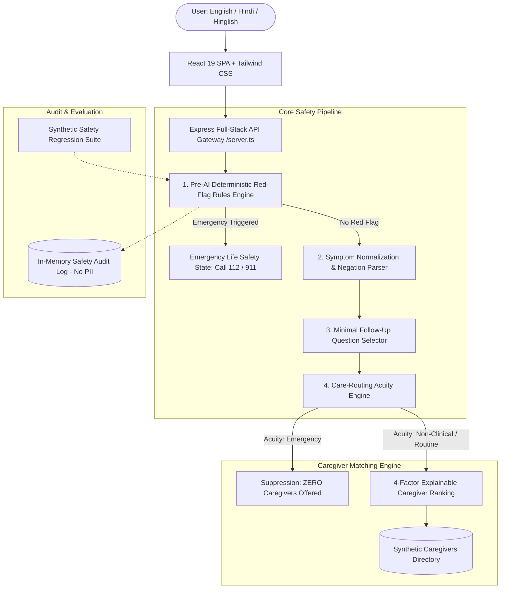

# CareCompass System Architecture

CareCompass is designed as a safety-first care-navigation and non-clinical caregiver matching platform. It implements a layered, deterministic defense model ensuring that artificial intelligence and search algorithms never override clinical emergency thresholds.

## 1. High-Level Architecture Diagram

## 2. Layered Modules & Separation of Concerns

### A. Pre-AI Deterministic Red-Flag Rules Engine (`v1.2.0-deterministic`)
- **Location**: `/src/services/redFlagRules.ts`
- **Execution Order**: 1st (pre-AI clinical gate).
- **Functionality**: Scans for 12 life-threatening emergency categories (possible stroke, acute coronary syndrome, severe respiratory compromise, unresponsiveness, prolonged seizures, arterial hemorrhage, anaphylaxis, toxic ingestions, major trauma, 3rd-trimester obstetric crises, severe burns, immediate self-harm).
- **Negation Safety**: Employs backward and forward clause inspection (up to 45 characters) to ensure negative assertions (e.g., "NO chest pain", "saans lene me koi dikkat nahi") do not trigger red flags.

### B. Language Normalization & Symptom Extraction
- **Location**: `/src/services/intakeParser.ts`
- **Functionality**: Normalizes free-text complaints in English, Hindi (Devanagari), and Hinglish into structured symptom mentions with confidence scores and duration tags.
- **AI Extension**: Pluggable `@google/genai` (Gemini 2.5 Flash) proxy on the server for clarification questions, strictly prevented from weakening or downgrading rule urgency.

### C. Follow-up Question Selector
- **Location**: `/src/services/followUpSelector.ts`
- **Functionality**: Curates at most 1–2 relevant questions from a reviewed question bank. Completely bypassed during emergency red flags to eliminate delay.

### D. Care-Routing Engine
- **Location**: `/src/services/careRoutingEngine.ts`
- **Functionality**: Produces a cautious care category (`EMERGENCY`, `URGENT`, `ROUTINE`, `NON_CLINICAL_SUPPORT`, `SELF_MONITOR`), transparent reason codes, uncertainty rating (`LOW`, `MEDIUM`, `HIGH`), and recommended timeframe.

### E. 4-Factor Caregiver Matching Engine
- **Location**: `/src/services/caregiverMatcher.ts`
- **Functionality**: Applies strict eligibility filtering, followed by an explainable scoring formula:
  $$\text{Score} = \text{Skill Fit (40\%)} + \text{Schedule Availability (25\%)} + \text{Service Area (20\%)} + \text{Language (15\%)}$$
- **Safety Invariant**: Returns `allowedToMatch: false` and zero profiles whenever acuity is `EMERGENCY`.
